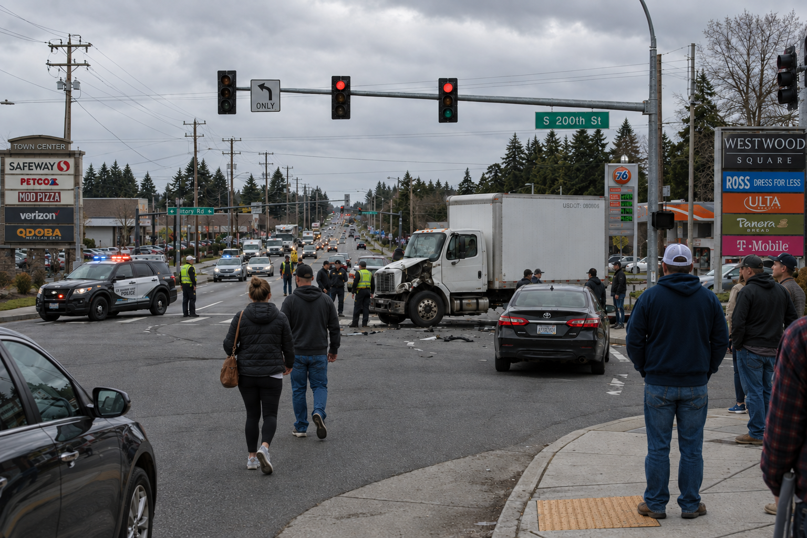

# Truck Crash

## Challenge Description
DEADFACE has been researching companies connected to one of its latest targets. Among the recovered files was a photograph of a traffic accident involving a commercial truck. Identify the company that owns the truck and determine its founding date.

## Solution

### 1. Identify the Truck
The truck's identification number is visible in the accident photograph. This is the **USDOT number**, a unique identifier assigned to commercial motor carriers by the U.S. Department of Transportation.

**Image evidence:**

The visible USDOT number is `080806`.

### 2. Identify the Company
Using the USDOT number, we identify the company as **J.B. Hunt Transport, Inc.**

### 3. Find the Founding Date
J.B. Hunt Transport, Inc. was founded on **August 10, 1961**.

The challenge requires the date in `MM_DD_YYYY` format.

## Flag

`deadface{08_10_1961}`
