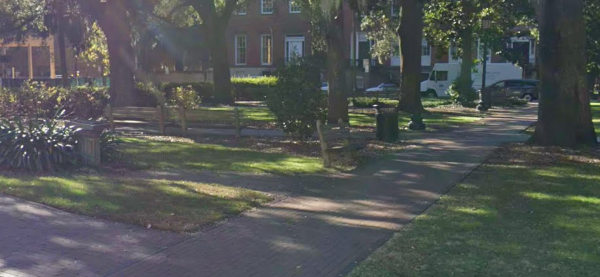
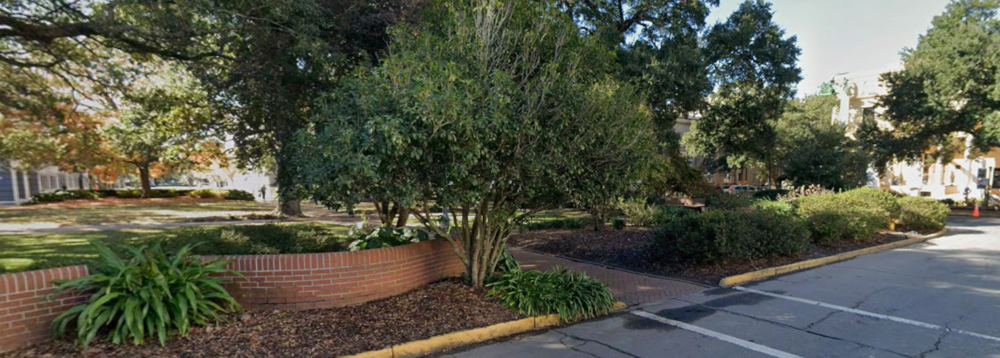

# DEADFACE CTF 2026: Ghost of Squares

**Category:** OSINT
**Flag format:** `Deadface{YEAR-YEAR-YEAR-YEAR-SURNAME}`

---

## Challenge Description

> Intelligence gathered from DEADFACE communications suggests that the group has been using Savannah, Georgia's historic squares to conceal a coded message. Investigators recovered five clues, a combination of riddles and photographs, each pointing to a specific location within the city's historic district.
>
> DEADFACE appears to have arranged these locations into a compass pattern, with the first four representing North, East, South, and West, and the fifth marking the center.
>
> Your mission is to identify all five locations and reconstruct the hidden message before DEADFACE can put it to use.
>
> For the first four locations, determine the year each square was established. For the final location, identify the surname engraved on its monument.
>
> Submit your findings in the order provided by the clues.

### Clues

**Point 1 (Riddle)**
> First of them all, where the city began, A banker's green heart in Oglethorpe's plan. A Quaker from Rhode Island sleeps under stone here. Mark the year this first square was laid out, and draw near.

**Point 2 (Photo):** see below

**Point 3 (Riddle)**
> Just a ways away a battle of a northern frontier Gave its name to this ground eighteen-twelve drawing near. Where a feather once drifted and a founder stands tall, Mark the year it was laid out, the newest of all.

**Point 4 (Photo):** see below

**Point 5 (Riddle)**
> Four points now marked, good work, you did your best. Their meeting point holds the key to this test. Carry their years in that order, and seek the lone name carved in the stone where their center lays claim.

---

## Approach

1. Solve the two riddles (Points 1 and 3). They name their squares unambiguously.
2. Use the compass structure (N, E, S, W, center) to work out where Points 2 and 4 must lie.
3. Use the center point to resolve Point 5.
4. Assemble the flag in clue order: N, E, S, W, then the center's surname.

---

## Point 1: North: Johnson Square (1733)

| Clue fragment | Inference |
|---|---|
| "First of them all, where the city began" | The first of Oglethorpe's squares, laid out when Savannah was founded |
| "A banker's green heart" | Johnson Square, in Savannah's financial district |
| "A Quaker from Rhode Island sleeps under stone" | Nathanael Greene (Rhode Island, Quaker upbringing), entombed under the Greene Monument in Johnson Square |

**Johnson Square was laid out in 1733.**

---

## Point 2: East: Photo



**Observations**
- No sign, statue or plaque is visible, so a direct match is not possible.
- A shaded residential square with a brick path.
- Wooden rail fence around planted beds.
- Brick townhouses with tall windows across the street.
- This is consistent with the smaller residential squares in the historic district.

**Inference.** Points 1 and 3 both lie on Bull Street, a north-south axis. The East point should then lie on the cross axis through the center of the compass, to the east of the center square. The nearest candidate on that row is **Oglethorpe Square, laid out in 1742.**

*Confidence: moderate. This was inferred from the compass geometry and not matched to the photo. See Verification.*

---

## Point 3: South: Chippewa Square (1815)

| Clue fragment | Inference |
|---|---|
| "A battle of a northern frontier" / "eighteen-twelve" | Battle of Chippewa, War of 1812 |
| "Where a feather once drifted" | The bench scene from *Forrest Gump* |
| "A founder stands tall" | The James Oglethorpe monument |
| "The newest of all" | The latest founding date among the four squares |

**Chippewa Square was laid out in 1815.**

The "newest of all" line is a useful consistency check. 1815 is later than every other candidate year in this set.

---

## Point 4: West: Photo



**Observations**
- A curved low brick wall in the foreground.
- Street parking with a painted yellow curb.
- Dense live-oak canopy and a paved interior path.
- Pale, light-colored buildings at the edge of the square.

**Inference.** This is the mirror of Point 2. It should be the west neighbor on the same row as the center square. The nearest candidate is **Telfair Square, laid out in 1733** (originally St. James Square).

*Confidence: moderate. As with Point 2, this comes from the compass geometry, not a landmark match.*

---

## Point 5: Center: Wright Square (Gordon)

- Johnson (N) and Chippewa (S) are both on Bull Street, so the midpoint of the compass falls on **Wright Square**.
- Wright Square holds the **William Washington Gordon monument** (founder of the Central of Georgia Railway). The monument is the engraved "lone name" the riddle refers to.
- The Tomochichi boulder is also in Wright Square. It is a boulder with a marker, not a monument carrying a surname, so it was discarded in favor of Gordon.

**Surname: Gordon**

---

## Final Flag

Order: N (Johnson) → E (Oglethorpe) → S (Chippewa) → W (Telfair) → Center (Wright)

| Point | Square | Value |
|---|---|---|
| 1 (N) | Johnson Square | 1733 |
| 2 (E) | Oglethorpe Square | 1742 |
| 3 (S) | Chippewa Square | 1815 |
| 4 (W) | Telfair Square | 1733 |
| 5 (C) | Wright Square monument | Gordon |

```
Deadface{1733-1742-1815-1733-Gordon}
```

---

## Verification and Confidence

Points 1, 3 and 5 are solved directly from the riddles and are high confidence. **Points 2 and 4 were not matched to the photos.** They come from compass geometry, so they carry the most uncertainty (roughly 55-60% for the pair).

To confirm them, compare each photo against Google Street View for the candidate squares:
1. **Oglethorpe Square**: check the fence line and the brick buildings across the street against Point 2.
2. **Telfair Square**: check the curved brick wall and parking lane against Point 4.
3. If neither matches, re-derive the East and West squares and recompute the flag. A different East or West square also means re-checking whether Wright Square is still the center.

## Lessons

- Riddle clues usually carry two or three redundant identifiers (a person, a landmark, a pop-culture hook), so cross-check them before committing.
- When photos are generic, use the puzzle's own structure, such as the compass layout, to constrain the candidates.
- Always compare final answers against built-in sanity checks, such as the "newest of all" statement above.
